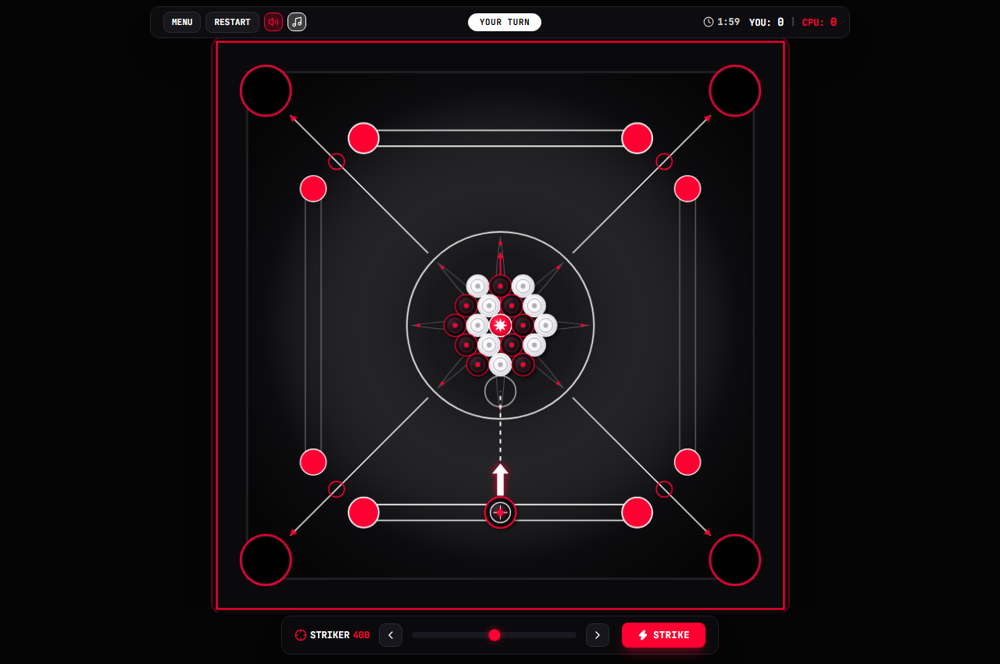
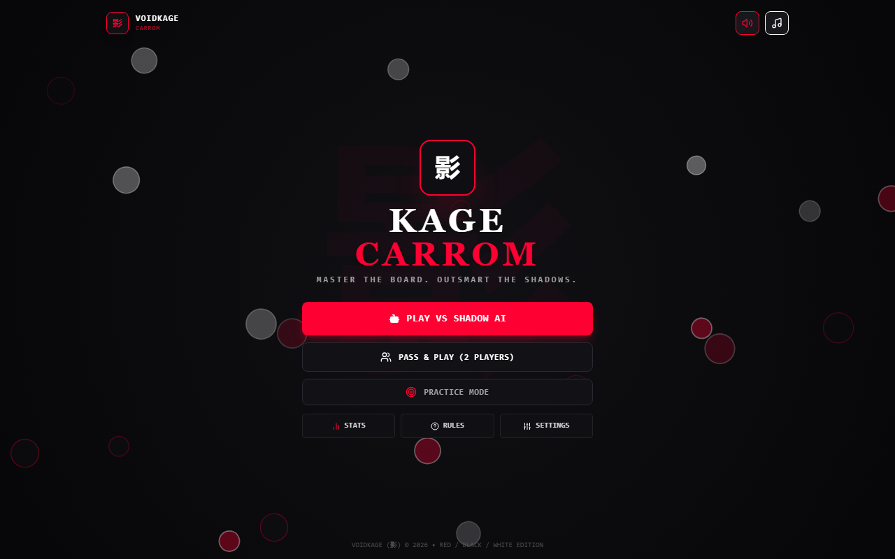

<div align="center">

# ⚡ KAGE CARROM (影)
### Master the Board • Outsmart the Shadows

[](https://isbandurahuman-r.github.io/KAGE-CARROM/)
[](https://github.com/ISBANDURAHUMAN-R)
[](https://react.dev/)
[](https://vitejs.dev/)
[](https://tailwindcss.com/)
[](https://brm.io/matter-js/)
[](LICENSE)

<br/>

<p align="center">
  <b>KAGE CARROM</b> is an ultra-crisp, high-performance 2D Carrom board game engine crafted with <b>React 19</b>, <b>Vite</b>, <b>HTML5 Canvas</b>, <b>Matter.js</b>, and <b>Tailwind CSS</b>. Blending authentic South Asian Carrom board heritage with a striking Japanese dark-minimalist (影 - Shadow) aesthetic.
</p>

<p align="center">
  <a href="https://isbandurahuman-r.github.io/KAGE-CARROM/"><strong>🚀 Play Live Demo »</strong></a>
  •
  <a href="#-key-features">Key Features</a>
  •
  <a href="#-official-carrom-rules">Rules</a>
  •
  <a href="#-quick-start">Quick Start</a>
  •
  <a href="#-author--credits">Author</a>
</p>

---

### 🎯 Live Gameplay Preview
*(Unmarked, full-resolution authentic rendering)*



<br/>

<details>
  <summary><b>👁️ Click to view Main Menu & Visual Theme</b></summary>
  <br/>
  
</details>

</div>

---

## 📖 Description

**KAGE CARROM** is a modern reimagining of the beloved tabletop game Carrom, engineered from the ground up for the modern web. Built with zero external canvas game frameworks—leveraging raw **HTML5 Canvas 2D API** and **Matter.js** rigid-body physics—it delivers sub-millimeter trajectory precision, real-time restitution simulation, and fluid 60+ FPS motion.

Designed and developed by **ISBANDU RAHUMAN R**, the game captures both the nostalgic feel of real wooden boards and the futuristic pulse of dark gaming culture:
- **Zero Gravity 2D Physics**: Accurate coefficient of restitution for hardwood timber rims (0.94) and smooth acrylic coins.
- **Boric Acid Powder Dynamics**: Simulates the exact gliding behavior of powdered carrom boards, customizable across Competition Standard, Fast Slick, and Vintage Heavy friction modes.
- **Complete Referee Engine**: Automated enforcement of official international Carrom federation rules: Queen covers, striker scratches, penalty coin returns, and turn-granting pocketing.
- **Raycasting AI Engines**: Three bespoke AI personalities from beginner-friendly Rookie to grandmaster Shadow Master calculating 1-cushion bank shots.
- **100% Procedural Web Audio API**: Zero external audio downloads. Resonant wooden strikes, acrylic clacks, pocket thuds, and ambient drones synthesized on-the-fly.

---

## 🌐 Live Demo

Experience Kage Carrom directly in your browser with zero installations:

[](https://isbandurahuman-r.github.io/KAGE-CARROM/)

🔗 **Direct URL**: [https://isbandurahuman-r.github.io/KAGE-CARROM/](https://isbandurahuman-r.github.io/KAGE-CARROM/)

---

## ✨ Key Features

| Feature | Description |
| :--- | :--- |
| 🪓 **Authentic Physics** | Matter.js 2D physics simulating board rim bounces, coin-to-coin impulse propagation, and suction pocket sinks. |
| 👑 **Queen & Cover Rules** | Full official cover validation: instant single-shot cover or sequential next-stroke verification. |
| 🤖 **3 AI Personalities** | **Rookie** (casual aiming), **Tactical** (direct path raycasting), and **Shadow Master** (bank shots & laser precision). |
| 🎮 **Multiple Game Modes** | Play vs AI, Local 2-Player Pass & Play, and Practice / Trickshot sandbox. |
| 🔊 **Procedural Audio** | Web Audio API synthesizer for striker knocks, pocket drops, foul alarms, and Queen shimmer. |
| 📱 **Mobile & Desktop** | Full multi-touch support, smooth slider controls, angle steppers, and mouse drag-and-aim mechanics. |
| 📊 **Career Statistics** | LocalStorage persistence for matches played, win streaks, pocket accuracy, and Queen capture tallies. |
| ⚙️ **Customizable Settings** | Fine-tune SFX volume, ambient drone, aiming assist guidelines, and board powder friction. |

---

## 📜 Official Carrom Rules

1. **Piece Allocation**:
   - **Player 1 (White pieces)**: 9 coins (10 points each)
   - **Player 2 / AI (Black pieces)**: 9 coins (10 points each)
   - **The Queen (Red coin)**: 1 center piece (+3 bonus points)
2. **Turn Retention ("Break")**:
   - Pocketing your own coin grants an immediate consecutive stroke ("Strike Again!").
3. **The Queen & Cover Requirement**:
   - The Queen must be "covered" by pocketing one of your own coins either on the exact same stroke (*Instant Cover*) or on the very next consecutive turn (*Sequential Cover*).
   - If the player fails to pocket their coin on the cover turn, the Queen returns to the center circle.
4. **Striker Scratches & Penalties**:
   - Pocketing the striker counts as a scratch: costs 1 penalty coin (returned from your stash to the center circle) and immediately forfeits the turn.
5. **Winning Condition**:
   - First player to clear all 9 of their designated coins (and settle the Queen) wins the match!

---

## 🕹️ Controls

| Action | Desktop (Mouse / Keyboard) | Mobile / Touch |
| :--- | :--- | :--- |
| **Striker Position** | Drag striker horizontally along baseline, or use slider / `<` and `>` nudge buttons | Touch and drag horizontally along baseline / slider |
| **Aiming Angle** | Move mouse cursor around board, or use Angle slider / `-1°` and `+1°` steppers | Slide angle controls or touch target point |
| **Target Snap** | Click **Snap Target** to auto-lock onto nearest viable coin | Tap **Snap Target** button |
| **Power Adjustment**| Drag power slider (10% to 100%) | Slide power gauge |
| **Strike** | Click **STRIKE** button, or drag-and-release directly on canvas | Tap **STRIKE** button |

---

## 🚀 Quick Start

### Prerequisites
- Node.js (v18.0.0 or higher recommended)
- npm or yarn

### Installation

```bash
# 1. Clone the repository
git clone https://github.com/ISBANDURAHUMAN-R/KAGE-CARROM.git

# 2. Navigate to project root
cd KAGE-CARROM

# 3. Install dependencies
npm install

# 4. Start local development server
npm run dev
```

Open `http://localhost:5173/` in your browser.

### Production Build

```bash
npm run build
npm run preview
```

---

## 📁 Project Architecture

```
kage-carrom/
├── .github/workflows/deploy.yml # GitHub Actions auto-deployment to GitHub Pages
├── screenshots/                 # High-resolution, unmarked UI and gameplay captures
│   ├── gameplay.png             # Full board game view
│   └── menu.png                 # Main menu and visual aesthetic
├── index.html                   # HTML entry point with Cinzel & Inter Google Fonts
├── tailwind.config.js           # Dark luxury VOIDKAGE palette & custom shadows
├── vite.config.js               # Vite build configuration with relative base paths
├── src/
│   ├── main.jsx                 # React root mount
│   ├── index.css                # Base styles & glassmorphism utilities
│   ├── App.jsx                  # Screen router & state coordinator
│   ├── game/
│   │   ├── constants.js         # Board dimensions, piece geometry, physics configs
│   │   ├── physics.js           # Matter.js world, collisions, pocket detectors, resting logic
│   │   ├── rules.js             # Official Carrom rules referee & state machine
│   │   ├── ai.js                # 3 AI tiers (Rookie, Tactical, Shadow Master + Bank shots)
│   │   └── renderer.js          # Canvas rendering, wood textures, aiming forecast, particles
│   ├── utils/
│   │   ├── audio.js             # Pure Web Audio API procedural synthesizer
│   │   └── storage.js           # LocalStorage persistence for stats & settings
│   └── components/
│       ├── MainMenu.jsx         # Logo, floating pieces canvas, play modes, difficulty selector
│       ├── GameView.jsx         # Canvas host, pointer handlers, AI turn sequencing
│       ├── ScoreBoard.jsx       # Top HUD, player cards, coin counters, turn banner
│       ├── AimControls.jsx      # Striker slider, angle steppers, power gauge, strike button
│       ├── StatsModal.jsx       # Career statistics dashboard & win rates
│       ├── SettingsModal.jsx    # SFX/Music volumes, guideline assist, friction speed
│       ├── RulesModal.jsx       # Illustrated carrom rulebook (Queen cover, fouls, scoring)
│       └── GameOverModal.jsx    # Confetti celebration, match breakdown, rematches
```

---

## 🛠️ Tech Stack

- **Frontend Framework**: [React 19](https://react.dev/)
- **Build Tool**: [Vite 8](https://vitejs.dev/)
- **Physics Simulation**: [Matter.js 0.20](https://brm.io/matter-js/)
- **Canvas Rendering**: HTML5 Canvas 2D Engine with Retina DPR scaling
- **Styling**: [Tailwind CSS 3.4](https://tailwindcss.com/)
- **Audio Synthesis**: Native Web Audio API (Zero external audio files)
- **Icons**: [Lucide React](https://lucide.dev/)
- **VFX**: [Canvas Confetti](https://www.npmjs.com/package/canvas-confetti)

---

## 👤 Author & Credits

Designed, architected, and built with passion by:

### **ISBANDU RAHUMAN R**
- 🐙 **GitHub Profile**: [@ISBANDURAHUMAN-R](https://github.com/ISBANDURAHUMAN-R)
- 💼 **Project Repository**: [https://github.com/ISBANDURAHUMAN-R/KAGE-CARROM](https://github.com/ISBANDURAHUMAN-R/KAGE-CARROM)

---

## 🏷️ Tags & Topics

`#carrom` `#carrom-board` `#react19` `#vite` `#matterjs` `#html5-canvas` `#physics-engine` `#game-development` `#javascript` `#tailwindcss` `#web-audio-api` `#board-game` `#arcade-game` `#indie-game` `#dark-mode` `#voidkage` `#kage-carrom` `#isbandu-rahuman-r` `#two-player-game` `#ai-opponent` `#tabletop-gaming`

---

## 📄 License

This project is licensed under the [MIT License](LICENSE) - see the LICENSE file for details.
