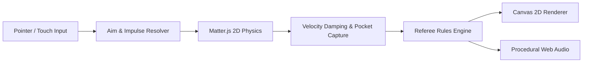

<p align="center">
  
</p>

# ◈ Kage Carrom

**Live Website:** [https://isbandurahuman-r.github.io/KAGE-CARROM/](https://isbandurahuman-r.github.io/KAGE-CARROM/)

## ◆ About the Project
Kage Carrom is a 2D physics-based web simulation of the traditional tabletop Carrom board game. It features accurate zero-gravity rigid-body dynamics, powder friction modeling, and official international rules enforcement including Queen cover mechanics and penalty scratches. The project also provides three distinct AI opponents utilizing geometric raycasting and cushion bank shot calculations.



## ❖ Key Features
- 2D top-down physics engine powered by Matter.js with realistic rebound restitution and pocket suction dynamics.
- Complete official Carrom referee system enforcing turn retention, Queen covering requirements, and penalty deductions.
- Three AI difficulty tiers (Rookie, Tactical, and Shadow Master) supporting direct and 1-cushion bank shots.
- Procedural audio synthesizer built with the Web Audio API with zero external audio asset dependencies.
- Local 2-player pass-and-play, single-player vs AI, and practice sandbox game modes.
- LocalStorage persistence for career statistics, match records, and game settings.
- Automated unit test suite with 100% pass rate covering referee scoring, turn alternation, and AI targeting heuristics.

## ⬢ Technologies Used
- React 19
- Vite 8
- Matter.js 0.20
- HTML5 Canvas 2D
- Tailwind CSS 3.4
- Web Audio API
- Lucide React
- Canvas Confetti
- Node.js Test Runner (`node:test`)

## § Requirements
- Node.js (v18.0.0 or higher)
- npm or yarn

## ▲ Installation & Execution
```bash
# Install dependencies
npm install

# Start development server
npm run dev

# Run automated unit test suite
npm test

# Run linter
npm run lint

# Build for production
npm run build
```

## ※ Developer
Developer: ISBANDU RAHUMAN R  
GitHub: https://github.com/ISBANDURAHUMAN-R  
Live Website: https://isbandurahuman-r.github.io/KAGE-CARROM/
